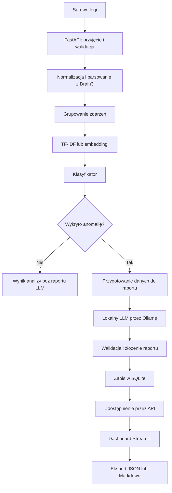

# Projekt-inzynierski-2026-2027

Projekt inżynierski: Zastosowanie modelu przetwarzania języka naturalnego (NLP) do
inteligentnej analizy logów systemowych i automatyzacji
raportowania incydentów bezpieczeństwa

## Zespół

| Osoba | Imię i nazwisko | Główna odpowiedzialność |
|---|---|---|
| Osoba 1 | Jakub Budziński | API, normalizacja i parsowanie logów, integracja przepływu analizy |
| Osoba 2 | Jakub Filus | Raporty LLM, SQLite, dashboard Streamlit, eksport i Docker Compose |
| Osoba 3 | Hubert Dyda | Przygotowanie danych, modele detekcji, eksperymenty i ocena skuteczności |

## Opis projektu

Projekt zakłada opracowanie prototypu systemu wspomagającego analizę logów systemowych i identyfikację podejrzanych zdarzeń.

System będzie przyjmować logi przez REST API, porządkować je i analizować za pomocą metod przetwarzania języka naturalnego oraz klasyfikatora. Dla wykrytych anomalii lokalny model językowy przygotuje opis sytuacji i rekomendację dla administratora.

Raporty będą zapisywane w bazie SQLite i udostępniane w dashboardzie Streamlit, umożliwiającym przeglądanie historii oraz eksport do JSON i Markdown.

W pierwszej wersji planowana jest obsługa logów uwierzytelniania Linux/OpenSSH.

## Cel projektu

Celem projektu jest zbudowanie i ocena prototypu łączącego wykrywanie anomalii w logach z automatycznym przygotowaniem czytelnego raportu.

Projekt obejmuje:

- porównanie detekcji opartej na TF-IDF z podejściem wykorzystującym embeddingi;
- ocenę skuteczności detekcji za pomocą Precision, Recall i F1-score;
- ocenę kompletności raportów i ich zgodności z logami źródłowymi;
- udostępnienie wyników w prostym interfejsie użytkownika.

System będzie wspomagać ocenę zdarzeń przez administratora. Automatyczne blokowanie adresów IP i inne działania zmieniające infrastrukturę pozostają poza zakresem projektu.

## Planowany przepływ danych

### 1. Przyjęcie logów — Osoba 1

API przyjmie paczkę surowych logów i sprawdzi poprawność danych wejściowych.

### 2. Normalizacja i parsowanie — Osoba 1

Logi zostaną przekształcone w uporządkowane zdarzenia. Drain3 posłuży do rozpoznawania powtarzalnych szablonów komunikatów, a dodatkowy kod wyodrębni dostępne pola, takie jak czas, host, użytkownik i adres IP.

Oryginalna treść logów zostanie zachowana jako materiał źródłowy do weryfikacji wyników.

### 3. Grupowanie zdarzeń — Osoba 1 i Osoba 3

Zdarzenia będą grupowane zgodnie z wymaganiami modelu, np. według hosta, adresu IP i przedziału czasu. Umożliwi to analizę serii zdarzeń, takich jak wielokrotne nieudane logowania.

Osoba 3 określi sposób grupowania potrzebny do detekcji, a Osoba 1 zaimplementuje go w aplikacji.

### 4. Wykrywanie anomalii — Osoba 3

Tekst zostanie przekształcony w wektory cech przy użyciu TF-IDF lub modelu embeddingowego. Klasyfikator oceni otrzymane reprezentacje i zwróci wynik detekcji wraz z identyfikatorami analizowanych zdarzeń.

Modele będą trenowane i oceniane osobno. Podczas działania aplikacji wykorzystywany będzie zapisany model.

### 5. Generowanie raportu — Osoba 2

Dla wykrytej anomalii aplikacja przekaże do modułu raportowania powiązane zdarzenia i ich dane.

Lokalny LLM przygotuje opis sytuacji oraz rekomendację. Pola faktograficzne, takie jak host, czas i liczba zdarzeń, zostaną uzupełnione na podstawie danych wejściowych.

Struktura odpowiedzi będzie walidowana przez Pydantic, a zgodność treści z logami będzie sprawdzana oddzielnie.

### 6. Zapis i prezentacja — Osoba 2

Raport zostanie zapisany w SQLite wraz z powiązaniami do zdarzeń źródłowych.

Dashboard Streamlit będzie pobierać dane przez API i umożliwi przeglądanie historii, otwieranie szczegółów oraz eksport raportów do JSON i Markdown. Endpointy raportów zostaną uzgodnione z Osobą 1.

## Planowane technologie

| Obszar | Technologie |
|---|---|
| Język programowania | Python |
| API i modele danych | FastAPI, Pydantic |
| Parsowanie logów | Drain3 |
| Detekcja i ewaluacja | scikit-learn |
| Embeddingi | Sentence-Transformers, PyTorch |
| Lokalny model językowy | Ollama |
| Baza danych | SQLite |
| Interfejs użytkownika | Streamlit |
| Konteneryzacja | Docker, Docker Compose |

## Dane i weryfikacja

Planowane jest wykorzystanie odpowiednio dobranych zbiorów z repozytorium Loghub, po sprawdzeniu dostępności etykiet i zgodności z zakresem analizy. Uzupełnieniem mogą być logi z kontrolowanych scenariuszy laboratoryjnych.

Weryfikacja obejmie testy API, parsowania, zapisu i eksportu, porównanie skuteczności modeli oraz ocenę jakości raportów.

## Możliwe rozszerzenia

- Eksport raportów do PDF.
- Integracja z demonstracyjnym środowiskiem SIEM.
- Obsługa kolejnych rodzajów logów.
